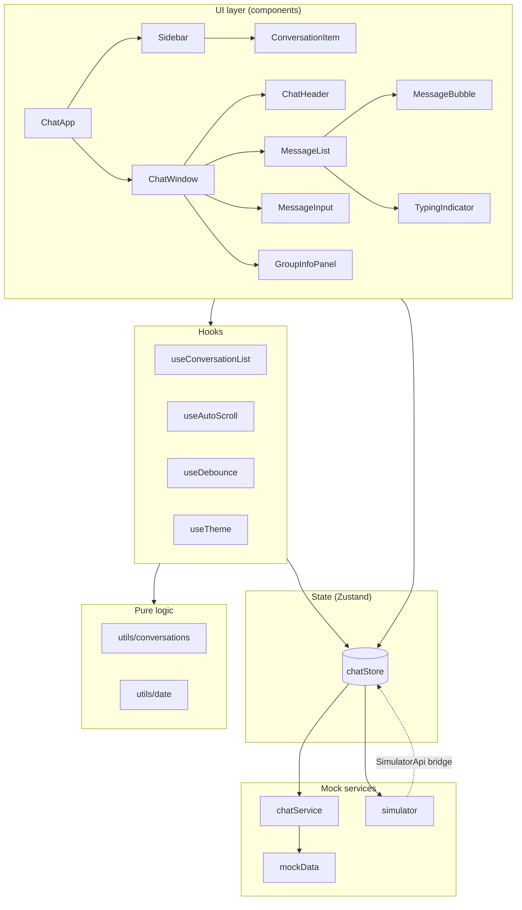

# Chat App — Senior Frontend Take-Home

A responsive, Slack/WhatsApp-Web-style chat application. Frontend only: all data, delivery receipts, typing indicators and incoming messages are simulated in the browser.

**Stack:** Next.js 14 (App Router) · React 18 · TypeScript (strict) · Tailwind CSS · Zustand · React Hook Form · Lucide · Vitest + Testing Library

## Getting started

```bash
npm install
npm run dev        # http://localhost:3000
npm test           # run unit tests
npm run typecheck  # tsc --noEmit
npm run lint
npm run build && npm start   # production build
```

Requires Node 18.18+.

Tip: open `http://localhost:3000/?error=1` to see the error state and the retry flow.

## Feature checklist

| Area | Delivered |
| --- | --- |
| Sidebar | Conversation list, initials avatars with online dot, last message + timestamp, unread badges, debounced search (Ctrl/Cmd+K), All / Unread / Groups filters |
| Chat window | Send/receive, timestamps, delivery ticks (sending → sent → delivered → read), reply-to with jump-to-original, smart auto-scroll + "jump to latest", typing indicator |
| Message actions | Edit, delete (soft), reply, copy, emoji reactions (toggle), date grouping (Today / Yesterday / date) |
| Groups | Info panel, member list with presence, add / remove members (mock) |
| UX | Responsive (mobile list↔chat navigation, tablet, desktop), loading skeletons, empty / no-results / error states, in-chat message search with highlight, "New messages" divider, Enter to send, Shift+Enter newline, Esc cancels reply/edit, light/dark theme (persisted, no flash) |
| Optional | Optimistic sending, debounced search, LocalStorage persistence, infinite older-message loading, offline send queue simulation, local attachment previews (5 MB limit) |

## Architecture



```
src/
  app/                     Next.js shell (layout, page, globals.css)
  features/chat/
    ChatApp.tsx            Composition root (init, simulation lifecycle, responsive layout)
    types.ts               Message / Conversation / User models
    components/            Presentational + container components
    hooks/                 useConversationList, useAutoScroll, useDebounce, useTheme
    store/chatStore.ts     Single Zustand store (state + actions)
    services/              chatService (mock API), simulator (incoming traffic), mockData
    utils/                 Pure helpers: date grouping, list filtering, cn/uid
    __tests__/             Vitest suites
```

## State management & key decisions

- **Zustand over Redux Toolkit.** The domain is one cohesive slice (conversations, messages, UI selections). Zustand gives centralized state and typed actions with minimal ceremony; components subscribe with narrow selectors, and `React.memo` on `MessageBubble`/`ConversationItem` works because updates are immutable and only touch the changed message.
- **Normalised data.** `messages` is a `Record<conversationId, Message[]>`; users are a `Record<id, User>`. Derived data (filtered list, previews, date groups) is computed with `useMemo` or pure functions, never stored.
- **UI / logic separation.** Components render and dispatch. Filtering, sorting, previews and date grouping live in `utils/` as pure, unit-tested functions. Scroll behaviour is isolated in `useAutoScroll`.
- **Service boundary.** The store only talks to `chatService`; swapping the mock for `fetch`/WebSocket changes service bodies, not UI. The simulator depends on a small `SimulatorApi` interface instead of importing the store, avoiding a circular dependency.
- **Optimistic sending.** A message is appended immediately as `sending`; the service advances it through `sent → delivered → read`. Status only moves forward (`STATUS_RANK`), so late callbacks cannot regress it.
- **Hydration safety.** Mock data contains `Date.now()`-relative timestamps, so it is loaded client-side after mount (with a skeleton) rather than during SSR. Theme is applied by a tiny inline script in `<head>` to avoid a flash.
- **Cleanup.** All timers (delivery, typing, background traffic) are tracked and cleared on unmount; global key listeners are removed in effect cleanups.
- **Accessibility.** Semantic landmarks, `role="log"` message list, labelled controls, visible focus, `aria-pressed`/`aria-selected` states, reduced-motion support.

## Assumptions, shortcuts & trade-offs

- **Avatars** are generated initials (no external image requests), so the app works offline.
- **Message list is not virtualised.** 90+ seeded messages render with memoised rows. For 10k+ messages, add a measured virtualizer such as `@tanstack/react-virtual`, flattening date-header and message rows while preserving the existing `groupByDate` helper.
- **Optional challenge trade-offs:** persistence, infinite older-message loading, offline queue simulation and local attachment previews are implemented. The 10k+ virtualized-list challenge and a real WebSocket transport remain unimplemented. No WebSocket server is bundled because the assessment requires no backend; incoming messages and typing are simulated by the lifecycle-safe client simulator. The `chatService` boundary is the integration point for a real WebSocket transport.
- **Delete** is a soft delete that shows a tombstone ("This message was deleted"), like WhatsApp/Slack.
- **Read receipts** are simulated on a fixed timer; real read state would come from the server.
- The current user is the fixed id `me`.

## Advanced optional challenges

### 10,000+ message virtualization

`MessageList` delegates message rendering to `VirtualMessageList`. It calculates cumulative row offsets, renders only the viewport plus eight overscan rows on either side, and uses `ResizeObserver` to measure variable-height message bubbles. The full message array remains in Zustand; only the visible DOM nodes are mounted. This keeps rendering work bounded by viewport size instead of mounting every message. To exercise the implementation, open `http://localhost:3000/?stress=10000` and select **Frontend Team**. The stress query creates 10,000 local test messages and bypasses persisted sample data for that session.

### WebSocket real-time simulation

The browser connects to `NEXT_PUBLIC_CHAT_WS_URL` (default `ws://localhost:3001`) through `services/websocket.ts`. The client handles incoming messages, typing events, presence updates, and delivery acknowledgements. The included `scripts/mock-websocket-server.mjs` is a local mock server using the `ws` package; it generates incoming messages and acknowledges outgoing messages. The in-process simulator remains active as a fallback when the WebSocket server is not running.

Run the app and mock socket server in two terminals:

```bash
# Terminal 1
npm run dev

# Terminal 2
npm run ws:mock
```

To use another server URL, set `NEXT_PUBLIC_CHAT_WS_URL` before starting Next.js. This is a mock protocol for the assessment, not a production chat backend: it has no authentication, durable server storage, rooms, or multi-instance coordination.
